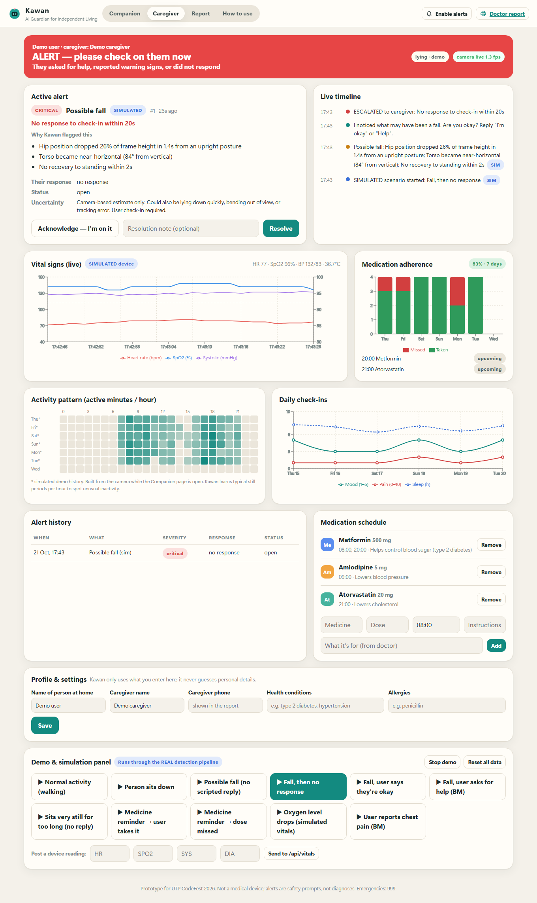
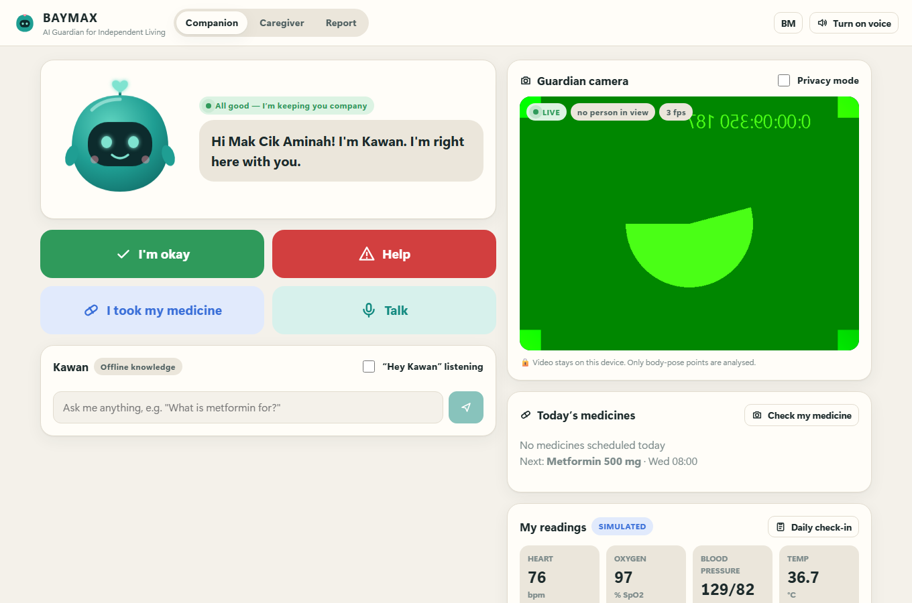
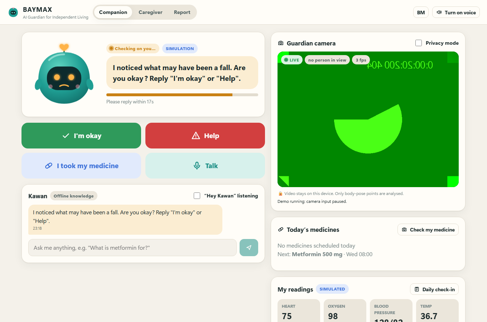
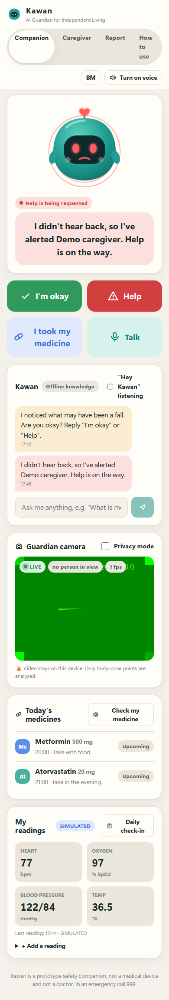
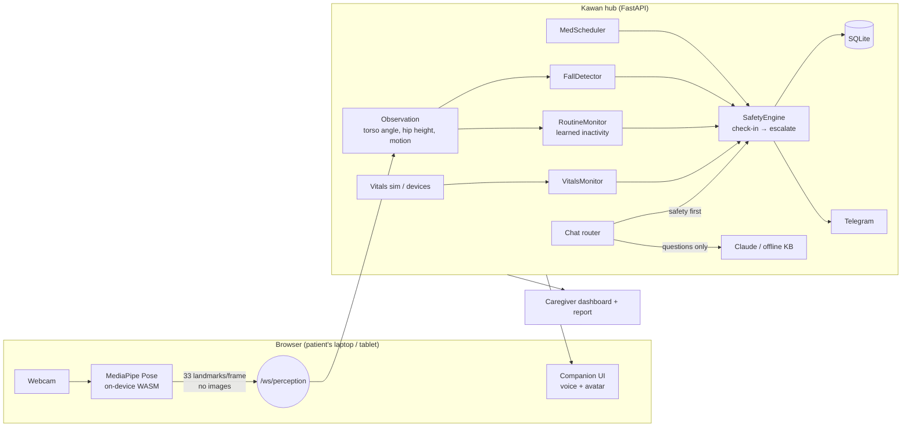

# Kawan — AI Guardian for Independent Living

> **Not a doctor. Not a surveillance camera. A guardian.**
> UTP CodeFest 2026 · HealthTech track · AI/ML · NLP · IoT software · Data analytics

Meet **Kawan** (Malay for *friend*), a home companion for people who live alone while sick, recovering or ageing. It runs on any laptop or tablet. It uses the device's own webcam to:

- watch for **falls** and **unusual inactivity**
- **remind** you to take medicines
- watch your **vital signs**
- **explain health topics** in plain English or Bahasa Melayu

It checks in with you before raising any alarm. If you need help, or don't answer, it **escalates to your caregiver** and tells them *why*.



*Screenshots taken in demo mode: the readings, history and profile shown are SIMULATED.*

| Companion (patient) | Check-in after a possible fall | Mobile |
|---|---|---|
|  |  |  |

---

> 📖 **Judges / reviewers:** [How to use the app](#quick-start) · [How the code works (CODE_GUIDE)](docs/CODE_GUIDE.md) · [Tests](#testing)

## Why

- Nearly **1 in 5 Malaysian adults has diabetes**, and hypertension and heart disease keep rising.
- Older adults juggling several prescriptions are at the highest risk, and so are people recovering at home alone.
- **Falls go unnoticed for hours.** Missed doses and early signs of deterioration are only found once there's a crisis.
- Most health apps track *passively* and in silos. Kawan turns home signals into **active, explainable care**:

```
notice → check in with the person → escalate only when needed → give the caregiver reasons
```

## What it does

| | Feature | How |
|---|---|---|
| 🧍 | **Fall detection** from the device's own camera | MediaPipe Pose runs **in the browser**. A temporal rule engine looks for an upright posture, then a rapid hip drop, then a horizontal torso, then staying down. Every alert comes with human-readable reasons. |
| 🪑 | **Unusual inactivity** | Learns how long *this person* usually stays still at each hour. Only flags during waking hours. |
| 💬 | **Check-in before alarm** | *"I noticed what may have been a fall. Are you okay?"* The person can answer by voice, a button or chat. Silence or "help" escalates. "I'm okay" lowers the severity. |
| 💊 | **Medication reminders** | Spoken reminders, snooze, *"I took my medicine"*, caregiver notice for missed doses, adherence chart. |
| 📷 | **Pill check** *(with API key)* | Hold the box up to the camera. Claude reads the label and matches it to your schedule. A photo is sent only when you tap the button. |
| ❤️ | **Vitals monitor** | Enter **real** readings from your own BP monitor, oximeter or thermometer, or have a device post to `POST /api/vitals`. Unusual readings trigger a check-in; oxygen and heart-rate alerts need **sustained** readings, so one bad reading isn't enough. |
| 🩺 | **Daily wellness check-in** | Mood, pain, sleep and symptoms. Gives non-diagnostic triage (*self-care / keep an eye on it / see a doctor today / call 999*). Red-flag symptoms escalate instantly. |
| 📚 | **Health literacy (EN/BM)** | Ask *"What is metformin for?"* or *"Apa itu darah tinggi?"* Answers come from a **curated, source-cited library of 71 topics** (Malaysian MOH clinical practice guidelines, WHO, NHS and others). **The source is shown under every answer.** With an API key, Claude answers grounded in that library, at low temperature, and must say "I'm not sure" rather than invent doses, numbers or personal details. |
| 🎙️ | **Voice companion** | Speaks every prompt. Listens with *"Hey Kawan…"*. During a check-in it accepts "I'm okay" or "Tolong" with no wake word. |
| 👨‍👩‍👧 | **Caregiver dashboard** | Live status, alert card with reasons and uncertainty, Acknowledge/Resolve, timeline, vitals, adherence, activity heatmap, wellness trends, browser notifications and sound. Optional **Telegram** phone alerts. |
| 🧾 | **Doctor-visit report** | One click to a printable or PDF summary: adherence, vitals ranges, symptoms, alerts, and questions to ask the doctor. |
| 🔒 | **Privacy by design** | Video **never leaves the device**. Only 33 body-pose points per frame go to the hub, and no images are stored. Privacy mode shows just the skeleton. |
| 📴 | **Works offline** | The pose model, WASM runtime, safety rules and knowledge base are all local. AI and Telegram are optional extras. |

## Safety design (what judges should know)

1. **Deterministic rules make every safety decision.** That covers falls, check-ins, escalation, red flags and medication state. All of it is unit-tested and explainable (`engine.py` rules R1–R10).
2. **The LLM only explains.** A reply to a check-in is *never* sent to the LLM. "Help" or red-flag symptoms are caught before any AI call. If Claude fails, the offline knowledge base answers.
3. **Fail-safe language handling.** Only an explicit "okay" clears a check-in. *"Okay but my leg hurts"* counts as help. Unclear replies keep the timer running.
4. **Honest uncertainty.** Every alert shows *why* it fired and *what else it could be*.
5. **No made-up data.** A fresh install has no invented patient, medicines, readings or history. Everything comes from what the user or caregiver enters, the camera, or a device. The AI is only given facts the app actually holds, and missing facts are marked as missing.
6. **Demo data is clearly separated.** The demo buttons label everything SIMULATED, and demo doses never count towards real adherence.

## Architecture



The demo scenarios generate *pose observations*, not fake alerts. That means the demo exercises the real detector and engine.

## Quick start

Requirements: **Python 3.12**, **Node 20+**, and **Chrome or Edge** (for camera and voice).

```powershell
# Windows
.\start.ps1
```
```bash
# macOS / Linux
./start.sh
```

Then open **http://localhost:8000**. The browser asks for camera permission and monitoring starts on its own. Open **http://localhost:8000/caregiver** in another tab, or on another screen, to see the caregiver view.

**First time?** Open **How to use** in the top menu (http://localhost:8000/guide). It's a step-by-step guide in English and Bahasa Melayu. Then fill in **Profile & settings** and the **Medication schedule** on the Caregiver page.

Optional: copy `.env.example` to `backend/.env` and add `ANTHROPIC_API_KEY` (Claude answers and pill check) or Telegram bot details.

<details><summary>Manual / development setup</summary>

```bash
cd backend
python -m venv .venv && .venv/Scripts/pip install -r requirements.txt   # (.venv/bin/pip on mac/linux)
.venv/Scripts/python -m uvicorn app.main:app --host 127.0.0.1 --port 8000

cd frontend
npm install
npm run dev          # hot-reload UI on http://localhost:5173 (proxies to :8000)
```
</details>

### Open it on a phone or tablet

Phones only allow camera access over HTTPS, so share the app through a free, temporary Cloudflare link. No account is needed (Windows):

```powershell
.\tunnel.ps1
```

It starts the app if it isn't already running, then prints a link like `https://xxxx.trycloudflare.com` and copies it to your clipboard. Open that link on the phone in Chrome (Android) or Safari (iPhone) and allow the camera. Add `/caregiver` to the link for the caregiver view. A nice demo: the phone is the patient, the laptop is the caregiver.

- The link works only while the laptop is on and the script is running. Press **Ctrl+C** to stop sharing.
- **The link changes every time you run the script.**
- **There is no login.** Share the link only with people you trust.
- Voice input works in Chrome on Android. On iPhone, use the buttons or typing (Kawan still speaks).

## 3-minute demo script

1. Open **Companion** (camera goes LIVE and your skeleton appears) and **Caregiver** side by side. Turn **voice on**.
2. Caregiver → Demo panel → **"Fall, then no response"**. Kawan looks concerned and asks *"Are you okay?"* while the countdown runs. After 20 s the caregiver banner turns red **ALERT**, beeps, and lists the reasons.
3. Click **Acknowledge**, then **Resolve** with a note.
4. **"Fall, user asks for help (BM)"**: *"Tolong, saya tak boleh bangun"* escalates instantly.
5. **"Medicine reminder → user takes it"**: a spoken reminder, then *"I took my medicine"*, then the adherence chart updates.
6. **"Oxygen level drops"**: SpO2 drifts below 92% on the live chart, and a sustained-reading rule triggers a check-in.
7. Ask Kawan: *"What is metformin for?"*, then *"Apa tanda strok?"*
8. **Daily check-in**: tick *Chest pain* to get an emergency triage, a "call 999" message and instant escalation.
9. Open the **Report** and use Print → PDF.
10. **Live**: step back so your whole body is in view, then sit or lie down quickly on a mat. A real camera-detected fall goes through the same pipeline.

## API (for devices and integrations)

| Method | Path | Purpose |
|---|---|---|
| `GET` | `/api/state` | Full live snapshot (also pushed on `WS /ws`) |
| `WS` | `/ws/perception` | Browser sends `{"lm": [[x,y,visibility]×33], "motion": n}` |
| `POST` | `/api/vitals` | `{"hr":72,"spo2":97,"sys":128,"dia":82,"temp":36.8,"source":"omron"}` |
| `POST` | `/api/chat` | `{"text":"..."}` → reply, route, source |
| `GET/POST/DELETE` | `/api/meds` | Medication schedule |
| `POST` | `/api/meds/take` · `/api/meds/snooze` | Dose actions |
| `POST` | `/api/wellness` | Daily check-in → triage |
| `POST` | `/api/pillcheck` | One JPEG → label reading (needs API key) |
| `GET` | `/api/insights?days=7` | Adherence, activity heatmap, wellness, vitals, incidents |
| `POST` | `/api/incidents/{id}/ack` · `/resolve` | Caregiver actions |
| `POST` | `/api/demo/{scenario}` | Run a simulated scenario through the real pipeline |

Interactive docs are at **http://localhost:8000/docs**.

## Testing

```bash
cd backend  && .venv/Scripts/python -m pytest -q     # 104 tests: detector, engine, meds, routine, vitals, triage, routing, grounded AI + citations, no-invented-data checks, API/WebSocket e2e
cd frontend && npm test                               # 19 unit tests: landmark packing, motion score, fuzzy "Hey Kawan" matching
cd frontend && npx playwright test                    # 12 browser e2e tests with a fake webcam (camera auto-start, fall → escalate → resolve, meds, cited answers, triage, settings, readings, guide, report)
```
GitHub Actions runs all three on every push.

## Project structure

**Want to read the code? Start with [docs/CODE_GUIDE.md](docs/CODE_GUIDE.md).** It explains every file in plain English and follows a fall, a question and a medicine reminder step by step through the code.

```
kawan/
├── backend/                  Python server ("the hub")
│   ├── app/
│   │   ├── main.py            web server: all URLs and live connections
│   │   ├── hub.py             coordinator: every input goes through here
│   │   ├── config.py          every adjustable threshold, in one place
│   │   ├── pose.py            33 body points → angle, hip height, posture
│   │   ├── fall_detector.py   "was that a fall?" (with reasons)
│   │   ├── inactivity.py      "still for unusually long?" (learns what's normal)
│   │   ├── vitals.py          heart rate / oxygen / BP / temperature rules
│   │   ├── medications.py     medicine schedule, reminders, adherence
│   │   ├── daily_checkin.py   daily check-in + emergency warning signs (EN/BM)
│   │   ├── safety_engine.py   ask "are you okay?" → escalate (rules R1–R10)
│   │   ├── conversation.py    Kawan's wording + understanding replies
│   │   ├── ai_answers.py      health answers (Claude or offline), always cited
│   │   ├── health_library.py  search over data/health_library.json (71 sourced topics)
│   │   ├── database.py        SQLite storage (never video)
│   │   ├── telegram_alerts.py optional phone alerts
│   │   └── demo_*.py          demo buttons (run through the real detectors)
│   └── tests/                 104 automated tests
├── frontend/                 Website (TypeScript + React)
│   ├── src/pages/             Companion · Caregiver · Report · How to use
│   ├── src/camera/            webcam + MediaPipe in the browser
│   ├── src/voice/             speaking, listening, "Hey Kawan"
│   ├── src/components/        Kawan mascot, charts, forms
│   └── e2e/                   browser tests with a fake webcam
├── docs/                     code guide + screenshots
├── start.ps1 / start.sh      one-command start
└── tunnel.ps1                share on phones (https link)
```

## Honest limitations

- Fall and inactivity detection are **heuristics, not clinically validated**. They assume a single camera and a single person, and work best when the whole body is in view.
- Lying down fast (for example onto a bed) can look like a fall. That's exactly why Kawan checks in first.
- The browser tab must stay open and visible. Browsers slow down background tabs, so a dedicated tablet or kiosk works best.
- Vitals are simulated unless a device posts readings. Voice recognition needs Chrome or Edge, and Bahasa Melayu recognition quality varies.
- This is a hackathon prototype, **not a medical device**, and it does not diagnose. In an emergency, call **999**.

## Credits

Pose estimation: [MediaPipe](https://developers.google.com/mediapipe) (Apache 2.0). Charts: Recharts. AI: Anthropic Claude (optional).
Kawan's character and all UI are original. The product concept was inspired by the idea of a friendly healthcare companion and uses no third-party character designs.

MIT License.
